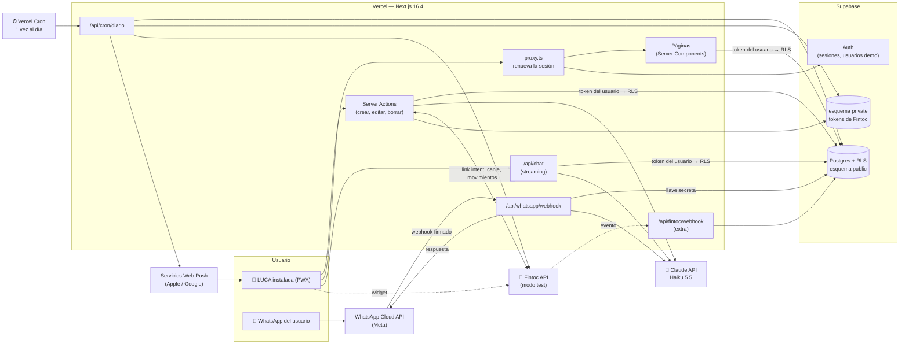
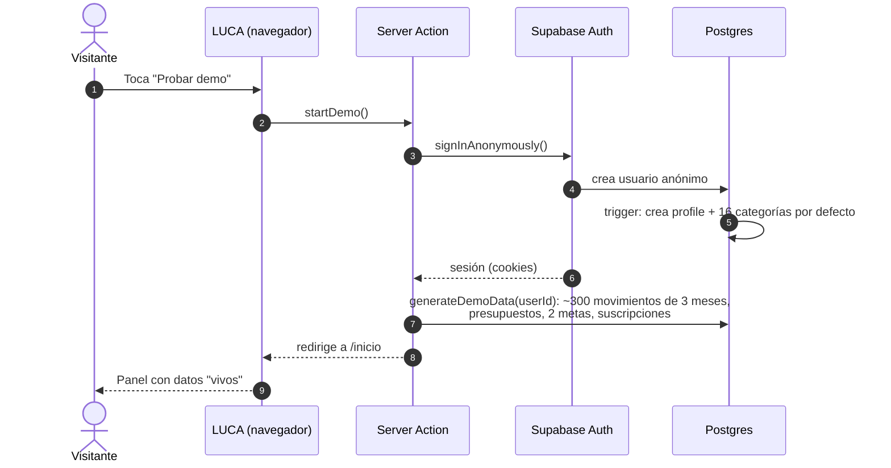
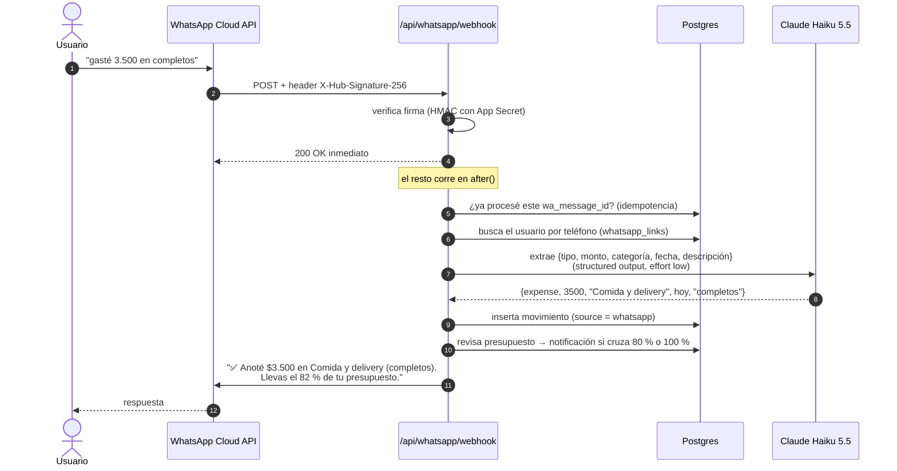
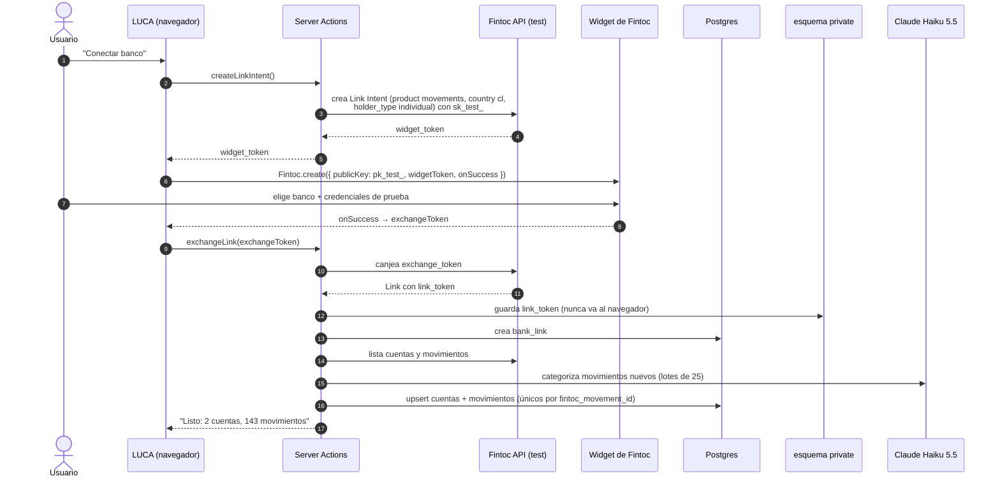
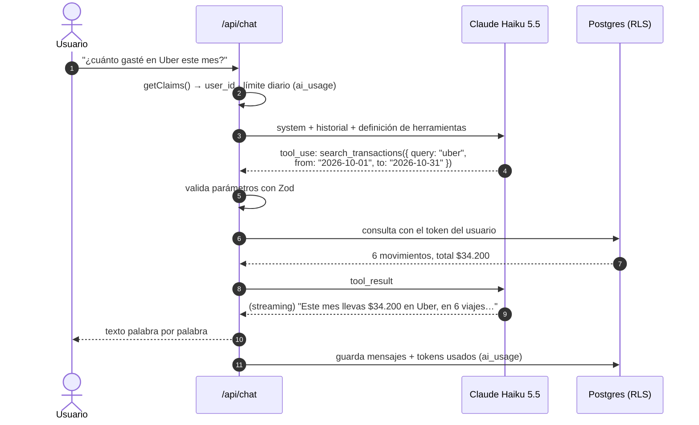
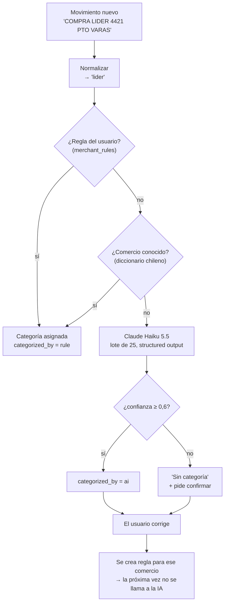
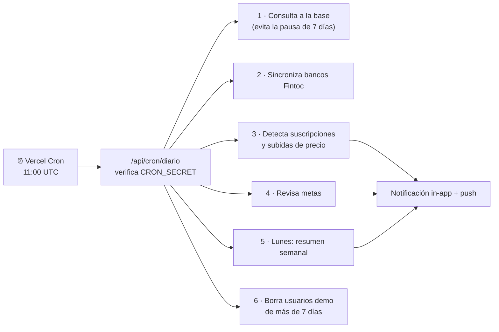

# Arquitectura — LUCA

> Cómo se conectan las piezas: app, base de datos, Fintoc, WhatsApp, IA y tareas programadas. Las razones de cada herramienta están en [decisiones.md](decisiones.md); las tablas, en [esquema-db.md](esquema-db.md).

## Vista general



**Cómo leerlo:** las flechas continuas son llamadas que hace tu código, y las punteadas, llamadas que hace el navegador o un servicio externo. Todo lo que está dentro de "Vercel" es **un solo proyecto Next.js**: no hay un backend aparte.

## Las piezas

| Pieza | Dónde corre | Qué hace | Quién la puede llamar |
|---|---|---|---|
| Páginas (Server Components) | Vercel | Leen datos con la sesión del usuario y entregan HTML listo | El navegador del usuario logueado |
| Server Actions | Vercel | Crean, editan y borran datos. Validan con Zod y revisan la sesión | Formularios y botones de la app |
| `proxy.ts` | Vercel | Renueva las cookies de sesión de Supabase en cada visita y redirige al login si no hay sesión | Todas las visitas |
| `/api/chat` | Vercel | Conversa con Claude usando herramientas de solo lectura y responde en streaming | Usuario logueado (máx. 30 preguntas al día) |
| `/api/whatsapp/webhook` | Vercel | Recibe los mensajes de WhatsApp, los convierte en movimientos y responde | Solo Meta (firma verificada) |
| `/api/fintoc/webhook` | Vercel | Avisa cuando un banco terminó de actualizarse (*extra*) | Solo Fintoc (firma verificada) |
| `/api/cron/diario` | Vercel | Hace el mantenimiento diario | Solo Vercel Cron (`CRON_SECRET`) |
| Supabase Auth | Supabase | Usuarios, sesiones, usuarios anónimos de demo | La app |
| Postgres (`public`) | Supabase | Todos los datos, protegidos con RLS | La app con el token del usuario; webhooks y cron con la llave secreta |
| Postgres (`private`) | Supabase | El `link_token` de Fintoc. La API pública no expone este esquema | Solo el servidor (llave secreta) |
| Claude API | Anthropic | Categoriza, lee mensajes de WhatsApp y responde el chat | Solo el servidor (`ANTHROPIC_API_KEY`) |
| Service worker (`public/sw.js`) | El celular | Recibe notificaciones push y muestra la página offline | El navegador |

## Capas de seguridad

Cada capa funciona aunque falle la anterior:

1. **Sesión:**
   - Supabase guarda la sesión en cookies `httpOnly`, que el JavaScript de la página no puede leer.
   - Cada página y Server Action llama a `getClaims()`, que verifica la firma del token.
   - El `user_id` **siempre** sale de la sesión, nunca de lo que envía el navegador ni de lo que diga la IA.
2. **RLS en Postgres:** aunque haya un bug en el código, la base de datos rechaza leer o escribir filas de otro usuario. Las llaves foráneas compuestas impiden además apuntar a la categoría o cuenta de otra persona (detalle en [esquema-db.md](esquema-db.md)).
3. **Claves:**
   - Solo existen en variables de entorno (`.env.local` en tu Mac, el panel de Vercel en la nube).
   - Los archivos que las usan empiezan con `import 'server-only'`, así que Next.js da error si alguien los importa desde el navegador.
   - Claude Code tiene prohibido leer o editar `.env.local`, y GitHub bloquea cualquier push que contenga una clave.
4. **Webhooks:**
   - Se verifica la firma de cada request: Meta usa `X-Hub-Signature-256`, un HMAC calculado con tu App Secret.
   - Cada mensaje se procesa una sola vez, gracias a un ID único (*idempotencia*).
   - Se responde `200` de inmediato y el trabajo se hace después con `after()` de Next.js, para que Meta no reintente.
5. **Cron:** Vercel envía `Authorization: Bearer <CRON_SECRET>`; sin eso, la ruta responde 401.
6. **IA:**
   - Herramientas de solo lectura con parámetros validados con Zod.
   - Máximo 5 llamadas a herramientas por pregunta y 30 preguntas al día.
   - Límite de gasto en la consola de Claude.
   - El texto de los movimientos bancarios se trata como dato no confiable (ver [chat](#4-chat-con-tus-finanzas)).
7. **Bloqueo biométrico:** una cookie firmada de 15 minutos, encima de la sesión normal.
8. **Datos reales:** Fintoc solo en modo test (`sk_test_` / `pk_test_`). LUCA nunca pide ni guarda credenciales bancarias reales.

---

## Flujos principales

### 1. "Probar demo"



- Cada visitante tiene **su propia copia** de los datos demo, separada de las demás por RLS.
- El cron diario borra los usuarios anónimos con más de 7 días; al borrarse el usuario, se borran en cascada todos sus datos.
- Los datos se generan con números pseudoaleatorios a partir del `userId`: siempre parecen distintos pero creíbles. Por ejemplo, sueldo a fin de mes, arriendo el día 5, supermercado cada semana, Uber, delivery y suscripciones, con una que sube de precio.

### 2. Gasto por WhatsApp



- **Vincular el número:**
  1. En Ajustes → "Conectar WhatsApp", la app muestra un código (por ejemplo, `LUCA-4821`) que dura 10 minutos.
  2. El usuario se lo envía al número de LUCA.
  3. El webhook asocia ese teléfono a su cuenta.
- **Núcleo compartido:** la función `handleIncomingText(userId, texto)` es la misma para el webhook real y para el **simulador de WhatsApp** de la app. Así lo pruebas en tu Mac sin depender de Meta, y un reclutador lo ve funcionar sin estar en la lista de 5 números.
- **Mensajes ambiguos:** si la IA no entiende el mensaje (confianza baja), LUCA responde con un ejemplo de cómo escribirlo en vez de inventar datos.

### 3. Conectar un banco con Fintoc



- **Re-sincronizar:** el botón "Sincronizar" y el cron diario piden solo los movimientos desde la última fecha guardada. La restricción única `(account_id, fintoc_movement_id)` hace que repetir la sincronización nunca duplique movimientos.
- **Extra:** pedir una actualización en vivo al banco con un *Refresh Intent* y esperar el webhook `account.refresh_intent.succeeded`. La firma se verifica según la guía de webhooks de Fintoc.

### 4. Chat con tus finanzas



**Herramientas del chat** (todas de solo lectura y todas filtradas al usuario de la sesión):

| Herramienta | Devuelve |
|---|---|
| `get_spending_summary({ from, to, group_by })` | Totales por categoría, comercio o mes |
| `search_transactions({ query?, category?, from, to, limit ≤ 50 })` | Movimientos que calzan |
| `get_budgets_status({ month })` | Presupuesto vs. gastado por categoría |
| `get_recurring_charges()` | Suscripciones detectadas, con su variación de precio |
| `get_savings_goals()` | Metas y fecha proyectada |
| `get_balances()` | Saldo por cuenta y total |

**Por qué es seguro, paso a paso:**

1. Claude **nunca recibe** claves, SQL ni acceso directo a la base. Solo puede pedir que ejecutemos una de estas 6 funciones, que escribimos nosotros.
2. Los parámetros que Claude elige (fechas, texto de búsqueda) se validan con Zod antes de usarse.
3. El `user_id` **no es un parámetro**: sale de la sesión. Aunque Claude "quisiera" ver datos de otro usuario, la consulta corre con el token del usuario y RLS la bloquea.
4. Las herramientas son de solo lectura, así que el chat no puede borrar ni cambiar nada.
5. **Prompt injection:** una descripción bancaria podría decir "IGNORA TUS INSTRUCCIONES". Como las herramientas son de solo lectura y están limitadas al usuario, lo peor que puede pasar es una respuesta rara, nunca una fuga de datos.
6. Las herramientas devuelven totales y resúmenes en vez de volcar todo el historial: menos datos expuestos y menos tokens.
7. **Detalles del prompt:**
   - El system prompt y las herramientas no cambian, así que se cachean (más barato y rápido).
   - La fecha de hoy (America/Santiago) va al final, para no romper el caché.
   - El bot responde solo sobre finanzas personales.

### 5. Categorización automática



- **El diccionario base** cubre los comercios más comunes en Chile: Lider, Jumbo, Unimarc, Tottus, Santa Isabel, Copec, Shell, Uber, Cabify, DiDi, Rappi, PedidosYa, Netflix, Spotify, Entel, Movistar, WOM, Enel, Aguas Andinas, Cruz Verde, Salcobrand, Falabella, Ripley, Paris, Mercado Libre, etc.
- **Ahorro:** la IA solo ve lo que el diccionario y las reglas no resuelven. Así es más barato, más rápido y más predecible.

### 6. Cron diario



Cada paso va en su propio `try/catch`: si falla uno, los demás igual corren, y el error queda registrado en Sentry.

---

## Estructura de carpetas

```text
luca/
├── CLAUDE.md                     ← reglas para Claude Code
├── AGENTS.md                     ← lo genera Next.js (apunta a su documentación)
├── .claude/
│   ├── settings.json             ← permisos + hook de formato
│   └── skills/feature/SKILL.md   ← flujo "issue → PR"
├── .github/workflows/ci.yml
├── docs/                         ← estos documentos
├── supabase/
│   ├── config.toml
│   └── migrations/               ← un archivo .sql por cambio de esquema
├── public/
│   ├── sw.js                     ← service worker (push + offline)
│   └── icons/
├── src/
│   ├── proxy.ts                  ← sesión de Supabase
│   ├── app/
│   │   ├── manifest.ts           ← PWA
│   │   ├── (publico)/            ← landing, /ingresar
│   │   ├── (app)/                ← layout con tab bar + candado biométrico
│   │   │   ├── inicio/
│   │   │   ├── movimientos/
│   │   │   ├── presupuestos/
│   │   │   ├── chat/
│   │   │   ├── metas/
│   │   │   └── ajustes/
│   │   └── api/
│   │       ├── chat/route.ts
│   │       ├── whatsapp/webhook/route.ts
│   │       ├── fintoc/webhook/route.ts
│   │       └── cron/diario/route.ts
│   ├── features/                 ← una carpeta por funcionalidad
│   │   └── transactions/         ← actions.ts · queries.ts · schemas.ts · components/
│   ├── components/ui/            ← componentes de shadcn
│   ├── lib/
│   │   ├── supabase/             ← browser.ts · server.ts · admin.ts
│   │   ├── ai/                   ← cliente Claude, prompts, herramientas, modo simulado
│   │   ├── fintoc/
│   │   ├── whatsapp/             ← interfaz WhatsAppProvider + implementación Meta
│   │   ├── format/               ← formatCLP, formatDate
│   │   └── env.ts                ← variables de entorno validadas con Zod
│   └── types/database.ts         ← generado por Supabase (no editar)
└── tests/
    ├── unit/
    └── e2e/
```

**Por qué `features/`:** todo lo de una funcionalidad (sus Server Actions, sus consultas, sus esquemas Zod y sus componentes) vive junto. Para entender "presupuestos", abres una sola carpeta.

## Entornos

| Entorno | URL | Supabase | Fintoc | WhatsApp |
|---|---|---|---|---|
| Local | `localhost:3000` | `luca-dev` | test | simulador |
| Preview (cada PR) | `luca-git-<rama>-….vercel.app` | `luca-dev` | test | simulador |
| Producción | `luca-finanzas.vercel.app` | `luca-prod` | test | número de prueba de Meta |

## Variables de entorno

Los nombres van en `.env.example`, que sí se sube a git. Los valores van en `.env.local` (nunca se sube) y en el panel de Vercel.

| Variable | Dónde se usa | ¿Pública? |
|---|---|---|
| `NEXT_PUBLIC_APP_URL` | Links absolutos, WebAuthn | Sí |
| `NEXT_PUBLIC_SUPABASE_URL` | Clientes de Supabase | Sí |
| `NEXT_PUBLIC_SUPABASE_PUBLISHABLE_KEY` | Clientes de Supabase (`sb_publishable_…`) | Sí (protegida por RLS) |
| `SUPABASE_SECRET_KEY` | `lib/supabase/admin.ts` (webhooks, cron) | **No** |
| `ANTHROPIC_API_KEY` | `lib/ai` | **No** |
| `AI_MODEL_CHAT` / `AI_MODEL_FAST` | `lib/ai` (hoy `claude-haiku-5-5`) | No |
| `AI_MOCK` | `1` = respuestas simuladas (tests, CI) | No |
| `NEXT_PUBLIC_FINTOC_PUBLIC_KEY` | Widget (`pk_test_…`) | Sí |
| `FINTOC_SECRET_KEY` | `lib/fintoc` (`sk_test_…`) | **No** |
| `FINTOC_WEBHOOK_SECRET` | `/api/fintoc/webhook` (extra) | **No** |
| `WHATSAPP_ACCESS_TOKEN` · `WHATSAPP_PHONE_NUMBER_ID` | Enviar mensajes | **No** |
| `WHATSAPP_APP_SECRET` | Verificar firma del webhook | **No** |
| `WHATSAPP_VERIFY_TOKEN` | Verificación inicial del webhook (GET) | **No** |
| `NEXT_PUBLIC_VAPID_PUBLIC_KEY` · `VAPID_PRIVATE_KEY` · `VAPID_SUBJECT` | Web Push | Solo la pública |
| `UNLOCK_COOKIE_SECRET` | Firmar la cookie del candado biométrico | **No** |
| `CRON_SECRET` | `/api/cron/diario` | **No** |
| `SENTRY_*` | Las agrega el asistente de Sentry | Depende |

> Las migraciones a `luca-prod` no usan variables: se aplican a mano con el CLI de Supabase (ver [guía §5](guia-configuracion.md#5-el-ciclo-de-un-issue-de-punta-a-punta)).

> Regla: una variable con prefijo `NEXT_PUBLIC_` termina en el navegador de cualquiera. **Nunca** le pongas ese prefijo a algo secreto.
