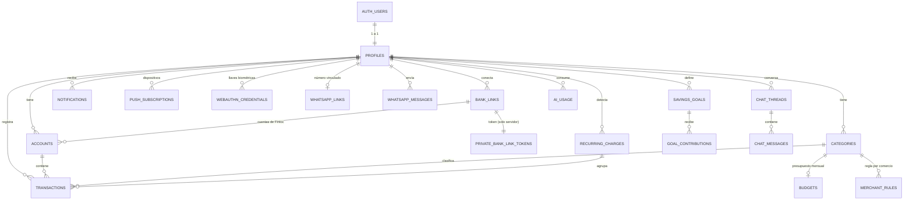

# Esquema de base de datos — LUCA

> Postgres 17 en Supabase. Esta es la propuesta. Se implementa por partes con migraciones SQL (`supabase/migrations/`) a medida que avanzan las semanas del [plan](plan.md).

## 7 reglas que siguen todas las tablas

1. **Dueño en cada fila:** `user_id uuid not null default auth.uid() references auth.users(id) on delete cascade`. Si se borra el usuario, se borra todo lo suyo; así limpiamos los usuarios demo con una sola línea.
2. **RLS activado en todas las tablas de `public`**, con políticas `(select auth.uid()) = user_id`. El `(select …)` hace que Postgres calcule el usuario una sola vez por consulta, no una vez por fila, y es mucho más rápido.
3. **Llaves foráneas compuestas `(user_id, x_id)`.** RLS revisa la fila que insertas, pero **no** a quién pertenece la fila a la que apuntas. Sin esto, alguien podría crear un movimiento con la categoría de otro usuario si adivinara su ID. Con la FK compuesta, la base exige que ambas filas sean del mismo dueño.
4. **Dinero en `bigint` (pesos enteros):** nunca `float` ni decimales. Signo como en una cartola: **negativo = gasto, positivo = ingreso**.
5. **Fechas:**
   - `occurred_on date` guarda el día del movimiento en hora de Chile, porque así lo piensa el usuario.
   - `created_at timestamptz` guarda el instante exacto, en UTC.
6. **Índices** en `user_id` + fecha, que es como se consulta casi todo.
7. **Lo sensible del servidor va en el esquema `private`.** La API pública de Supabase solo expone `public`.

## Diagrama de relaciones



---

## Tablas

> Columnas comunes que no se repiten abajo: `id uuid primary key default gen_random_uuid()`, `user_id` (regla 1) y `created_at timestamptz not null default now()`. Cada tabla con FK compuesta tiene además `unique (user_id, id)`.

### Núcleo (semana 2)

**`profiles`**: uno por usuario. Lo crea un trigger al registrarse.

| Columna | Tipo | Notas |
|---|---|---|
| `id` | `uuid` PK | `references auth.users(id) on delete cascade` (no usa `user_id`) |
| `display_name` | `text` | |
| `is_demo` | `boolean` | `default false` |
| `timezone` | `text` | `default 'America/Santiago'` |
| `onboarded_at` | `timestamptz` | null hasta completar la bienvenida |

- **Trigger `on_auth_user_created`:** llama a `public.handle_new_user()`. Es una función `security definer` con `set search_path = ''`, que crea el profile y copia las **16 categorías por defecto**:
  - **Gastos:** Supermercado 🛒, Comida y delivery 🍔, Transporte 🚌, Bencina ⛽, Cuentas básicas 💡, Arriendo o dividendo 🏠, Salud 💊, Educación 📚, Entretención 🎬, Suscripciones 📺, Compras 🛍️, Mascotas 🐶, Transferencias ↔️, Otros 📦.
  - **Ingresos:** Sueldo 💼, Otros ingresos 💰.

**`categories`**

| Columna | Tipo | Notas |
|---|---|---|
| `name` | `text not null` | `unique (user_id, name)` |
| `emoji` | `text` | |
| `color` | `text` | token del tema, por ejemplo `chart-3` |
| `kind` | `text not null` | `check (kind in ('expense','income'))` |
| `is_archived` | `boolean` | `default false` (archivar en vez de borrar conserva el historial) |
| `sort_order` | `int` | |

**`accounts`**

| Columna | Tipo | Notas |
|---|---|---|
| `name` | `text not null` | "Cuenta RUT", "Tarjeta de crédito" |
| `type` | `text not null` | `check (type in ('checking','savings','credit_card','cash','digital_wallet'))` |
| `institution` | `text` | "BancoEstado" |
| `source` | `text not null` | `check (source in ('manual','fintoc','demo'))` |
| `bank_link_id` | `uuid` | FK `(user_id, bank_link_id)` → `bank_links`, `on delete set null (bank_link_id)`. Se agrega en `0004` (S6), cuando existe `bank_links` |
| `fintoc_account_id` | `text` | `unique` |
| `balance_clp` | `bigint` | saldo informado; en tarjeta de crédito es deuda (negativo) |
| `balance_updated_at` | `timestamptz` | |
| `is_hidden` | `boolean` | `default false` |

**`transactions`**: el corazón de la app.

| Columna | Tipo | Notas |
|---|---|---|
| `account_id` | `uuid` | null = efectivo o sin cuenta. FK `(user_id, account_id)` → `accounts`, `on delete set null (account_id)` |
| `category_id` | `uuid` | null = sin categoría. FK `(user_id, category_id)` → `categories`, `on delete set null (category_id)` |
| `amount_clp` | `bigint not null` | `check (amount_clp <> 0)`. Negativo = gasto |
| `occurred_on` | `date not null` | fecha en Chile |
| `description_raw` | `text` | texto original del banco: "COMPRA LIDER 4421" |
| `merchant` | `text` | normalizado: "Lider" |
| `note` | `text` | nota del usuario |
| `source` | `text not null` | `check (source in ('manual','whatsapp','fintoc','demo'))` |
| `fintoc_movement_id` | `text` | `unique (account_id, fintoc_movement_id)`: evita duplicados al re-sincronizar |
| `categorized_by` | `text not null` | `default 'none'`, `check (… in ('user','rule','ai','none'))` |
| `ai_confidence` | `real` | 0 a 1 |
| `recurring_charge_id` | `uuid` | FK `(user_id, recurring_charge_id)` → `recurring_charges`, `on delete set null (recurring_charge_id)`. Se agrega en `0005` (S7) |
| `updated_at` | `timestamptz` | |

- **Índices:** `(user_id, occurred_on desc)` y `(user_id, category_id, occurred_on)`.
- **Detalle técnico:** `on delete set null (columna)` es sintaxis de Postgres 15 o posterior. Sin la lista de columnas, Postgres intentaría poner también `user_id` en null y fallaría, porque `user_id` es `not null`.

### Presupuestos, reglas y notificaciones (semanas 4 y 5)

**`budgets`**: siempre mensuales (para simplificar).

| Columna | Tipo | Notas |
|---|---|---|
| `category_id` | `uuid not null` | FK `(user_id, category_id)` → `categories`, `on delete cascade` · `unique (user_id, category_id)` |
| `amount_clp` | `bigint not null` | `check (amount_clp > 0)` |

Los umbrales de alerta (80 % y 100 %) viven en el código, no en la tabla.

**`merchant_rules`**: lo que la app "aprende" cuando corriges una categoría.

| Columna | Tipo | Notas |
|---|---|---|
| `pattern` | `text not null` | comercio normalizado ("lider") · `unique (user_id, pattern)` |
| `category_id` | `uuid not null` | FK compuesta → `categories`, `on delete cascade` |
| `merchant_display` | `text` | "Lider" |
| `created_from` | `text not null` | `check (created_from in ('user','ai'))` |

**`notifications`**

| Columna | Tipo | Notas |
|---|---|---|
| `type` | `text not null` | `budget_threshold`, `price_increase`, `goal_reached`, `weekly_summary`, `system` |
| `title` · `body` | `text not null` | en español de Chile |
| `url` | `text` | adónde lleva al tocarla (`/presupuestos`) |
| `dedupe_key` | `text not null` | `unique (user_id, dedupe_key)`. Ejemplo: `budget:<id>:2026-10:80` hace que nunca avise dos veces lo mismo |
| `read_at` | `timestamptz` | null = no leída |

**`push_subscriptions`**: un registro por celular o navegador.

| Columna | Tipo | Notas |
|---|---|---|
| `endpoint` | `text not null` | `unique` |
| `p256dh` · `auth` | `text not null` | llaves que entrega el navegador |
| `user_agent` | `text` | para mostrar "iPhone · Safari" en Ajustes |
| `last_used_at` | `timestamptz` | |

### IA (semana 5)

**`chat_threads`**: `title text`.

**`chat_messages`**

| Columna | Tipo | Notas |
|---|---|---|
| `thread_id` | `uuid not null` | FK `(user_id, thread_id)` → `chat_threads`, `on delete cascade` |
| `role` | `text not null` | `check (role in ('user','assistant'))` |
| `content` | `text not null` | solo el texto final; las herramientas se vuelven a ejecutar en cada pregunta |

**`ai_usage`**: costo y límite diario.

| Columna | Tipo | Notas |
|---|---|---|
| `feature` | `text not null` | `check (feature in ('chat','categorize','whatsapp'))` |
| `model` | `text not null` | `claude-haiku-5-5` |
| `input_tokens` · `output_tokens` · `cache_read_tokens` | `int` | lo que informa la API en `usage` |

- **Índice:** `(user_id, feature, created_at)`.
- **Límite diario:** el chat cuenta las filas de hoy antes de responder.

### Integraciones (semana 6)

**`bank_links`**: una conexión a un banco vía Fintoc.

| Columna | Tipo | Notas |
|---|---|---|
| `fintoc_link_id` | `text not null` | `unique` |
| `institution` | `text` | |
| `holder_type` | `text not null` | `default 'individual'` |
| `status` | `text not null` | `check (status in ('active','credentials_changed','error'))` |
| `last_synced_at` | `timestamptz` | |

**`private.bank_link_tokens`**: en el esquema `private`, invisible para la API.

| Columna | Tipo | Notas |
|---|---|---|
| `bank_link_id` | `uuid` PK | `references public.bank_links(id) on delete cascade` |
| `link_token` | `text not null` | equivale a las credenciales del banco; solo lo lee el servidor |
| `created_at` | `timestamptz` | |

**`whatsapp_links`**: vinculación del número.

| Columna | Tipo | Notas |
|---|---|---|
| `user_id` | `uuid` PK | uno por usuario |
| `phone_e164` | `text` | `unique` ("+56912345678"). Lo escribe **solo** el webhook |
| `link_code` | `text` | `unique` ("LUCA-4821") |
| `code_expires_at` | `timestamptz` | 10 minutos |
| `verified_at` | `timestamptz` | |

**`whatsapp_messages`**: registro e idempotencia.

| Columna | Tipo | Notas |
|---|---|---|
| `user_id` | `uuid` | null si el número no está vinculado |
| `wa_message_id` | `text not null` | `unique`: Meta reintenta los webhooks, y esto evita guardar el gasto dos veces |
| `from_phone` | `text not null` | |
| `body` | `text` | |
| `parsed` | `jsonb` | lo que extrajo la IA |
| `transaction_id` | `uuid` | movimiento creado |
| `status` | `text not null` | `check (status in ('received','processed','ignored','error'))` |

### Diferenciadores (semana 7)

**`recurring_charges`**: suscripciones detectadas. El nombre evita confusión con `push_subscriptions`.

| Columna | Tipo | Notas |
|---|---|---|
| `merchant` | `text not null` | `unique (user_id, merchant)` |
| `category_id` | `uuid` | FK compuesta, `on delete set null (category_id)` |
| `cadence_days` | `int not null` | ~30 |
| `avg_amount_clp` · `last_amount_clp` · `previous_amount_clp` | `bigint` | para detectar subidas de precio |
| `last_charged_on` · `next_expected_on` | `date` | |
| `status` | `text not null` | `check (status in ('active','dismissed','cancelled'))` |
| `detected_at` | `timestamptz` | |

**Regla de detección** (función pura en TypeScript, con tests):

1. Considera los gastos de los últimos 6 meses.
2. Los agrupa por comercio.
3. Un grupo es suscripción si tiene **3 o más cobros**, con intervalos de **26 a 35 días** y montos que varían **15 % o menos**.
4. Si `last_amount_clp` supera a `previous_amount_clp` en 5 % o más, se crea una notificación `price_increase`.

**`savings_goals`**

| Columna | Tipo | Notas |
|---|---|---|
| `name` | `text not null` | "Viaje a Chiloé" |
| `emoji` | `text` | |
| `target_clp` | `bigint not null` | `check (target_clp > 0)` |
| `target_date` | `date` | opcional |
| `completed_at` | `timestamptz` | |

**`goal_contributions`**

| Columna | Tipo | Notas |
|---|---|---|
| `goal_id` | `uuid not null` | FK `(user_id, goal_id)` → `savings_goals`, `on delete cascade` |
| `amount_clp` | `bigint not null` | negativo = retiro |
| `contributed_on` | `date not null` | |

**Proyección** (función pura con tests):

1. Ahorrado = suma de los aportes.
2. Faltante = meta − ahorrado.
3. Ritmo = promedio mensual de los aportes de los últimos 3 meses.
4. Meses restantes = faltante ÷ ritmo.
5. Resultado: "A este ritmo llegas en **marzo de 2027**". Si el ritmo es 0, la app muestra "Agrega un aporte para calcular".

**`webauthn_credentials`**: llaves del bloqueo biométrico.

| Columna | Tipo | Notas |
|---|---|---|
| `credential_id` | `text not null` | `unique` (base64url) |
| `public_key` | `bytea not null` | la huella **nunca** sale del celular; esto es solo la llave pública |
| `counter` | `bigint not null` | protege contra repetir una firma antigua |
| `transports` | `text[]` | |
| `device_label` | `text` | "iPhone de Simón" |
| `last_used_at` | `timestamptz` | |

El *challenge* temporal de WebAuthn no se guarda en una tabla: va en una cookie `httpOnly` firmada que dura 5 minutos.

---

## Políticas de seguridad (RLS)

### Plantilla (se repite por tabla)

```sql
alter table public.transactions enable row level security;

create policy "transactions: ver las propias"
  on public.transactions for select to authenticated
  using ((select auth.uid()) = user_id);

create policy "transactions: crear las propias"
  on public.transactions for insert to authenticated
  with check ((select auth.uid()) = user_id);

create policy "transactions: editar las propias"
  on public.transactions for update to authenticated
  using ((select auth.uid()) = user_id)
  with check ((select auth.uid()) = user_id);

create policy "transactions: borrar las propias"
  on public.transactions for delete to authenticated
  using ((select auth.uid()) = user_id);
```

Cómo leerlo:

- `using` decide **qué filas puedes ver o tocar**.
- `with check` decide **qué filas puedes dejar escritas**. Así, nadie puede cambiar el `user_id` de una fila a otro usuario.
- `to authenticated` incluye a los usuarios anónimos de la demo: para Postgres también son usuarios logueados.

### Matriz por tabla

"Propias" = `(select auth.uid()) = user_id`. "Servidor" = solo con la llave secreta (no hay política, así que el usuario no puede).

| Tabla | select | insert | update | delete | Por qué |
|---|---|---|---|---|---|
| `profiles` | propias (`id`) | servidor (trigger) | propias | servidor (cascade) | |
| `categories`, `accounts`, `transactions`, `budgets`, `merchant_rules`, `savings_goals`, `goal_contributions`, `chat_threads`, `chat_messages`, `push_subscriptions`, `webauthn_credentials` | propias | propias | propias | propias | datos del usuario |
| `recurring_charges` | propias | servidor | propias | servidor | las detecta el cron; el usuario solo cambia `status` |
| `notifications` | propias | servidor | propias | propias | el usuario marca como leída o borra |
| `bank_links` | propias | servidor | servidor | servidor | solo se crean tras el canje con Fintoc |
| `whatsapp_links` | propias | servidor | servidor | servidor | si el usuario pudiera escribir `phone_e164`, podría "robarse" un número ajeno |
| `whatsapp_messages` | propias | servidor | servidor | servidor | los escribe el webhook |
| `ai_usage` | propias | propias | — | — | sin update ni delete: nadie puede borrar su consumo para saltarse el límite |
| `private.bank_link_tokens` | — | — | — | — | esquema no expuesto + RLS activado sin políticas |

### Vistas y funciones

```sql
-- Gasto por mes y categoría. security_invoker hace que la vista respete el RLS
-- de quien consulta (sin esto, una vista se salta RLS).
create view public.monthly_category_spend
with (security_invoker = true) as
select
  user_id,
  date_trunc('month', occurred_on)::date as month,
  category_id,
  sum(-amount_clp) filter (where amount_clp < 0) as spent_clp,
  sum(amount_clp)  filter (where amount_clp > 0) as income_clp,
  count(*) as tx_count
from public.transactions
group by 1, 2, 3;
```

- `public.handle_new_user()`: trigger de registro (`security definer`, `set search_path = ''`).
- `public.budget_status(p_month date)`: presupuesto vs. gastado del mes (`security invoker`).
- Limpieza de demos (desde el cron, con la llave secreta):

  ```sql
  delete from auth.users
  where is_anonymous is true
    and created_at < now() - interval '7 days';
  ```

### Cómo verificamos que funciona

1. **Test de RLS** (Vitest contra `luca-dev`). Crea los usuarios A y B y comprueba que:
   - B no ve los movimientos de A (0 filas).
   - B no puede insertar con `user_id` de A (error).
   - B no puede crear un movimiento con una categoría de A (falla la FK compuesta).
2. **Advisors de Supabase:** después de cada migración, Claude corre `get_advisors` (seguridad y rendimiento) con el MCP de Supabase sobre `luca-dev`. Avisa si una tabla quedó sin RLS o le falta un índice.
3. **`/security-review`** antes de mergear cualquier PR que toque migraciones.

## Orden de las migraciones

| Semana | Migración | Contenido |
|---|---|---|
| S2 | `0001_core.sql` | `profiles`, `categories`, `accounts`, `transactions`, trigger, RLS, vista `monthly_category_spend` |
| S4 | `0002_budgets_notifications.sql` | `budgets`, `notifications`, `budget_status()` |
| S5 | `0003_ai.sql` | `merchant_rules`, `chat_threads`, `chat_messages`, `ai_usage` |
| S6 | `0004_integrations.sql` | esquema `private`, `bank_links`, `private.bank_link_tokens`, `whatsapp_links`, `whatsapp_messages` + columna `accounts.bank_link_id` |
| S7 | `0005_differentiators.sql` | `recurring_charges`, `savings_goals`, `goal_contributions`, `push_subscriptions`, `webauthn_credentials` + columna `transactions.recurring_charge_id` |

> Los nombres reales de los archivos llevan la fecha delante (`20261026120000_core.sql`). Los genera `npx supabase migration new core`.
